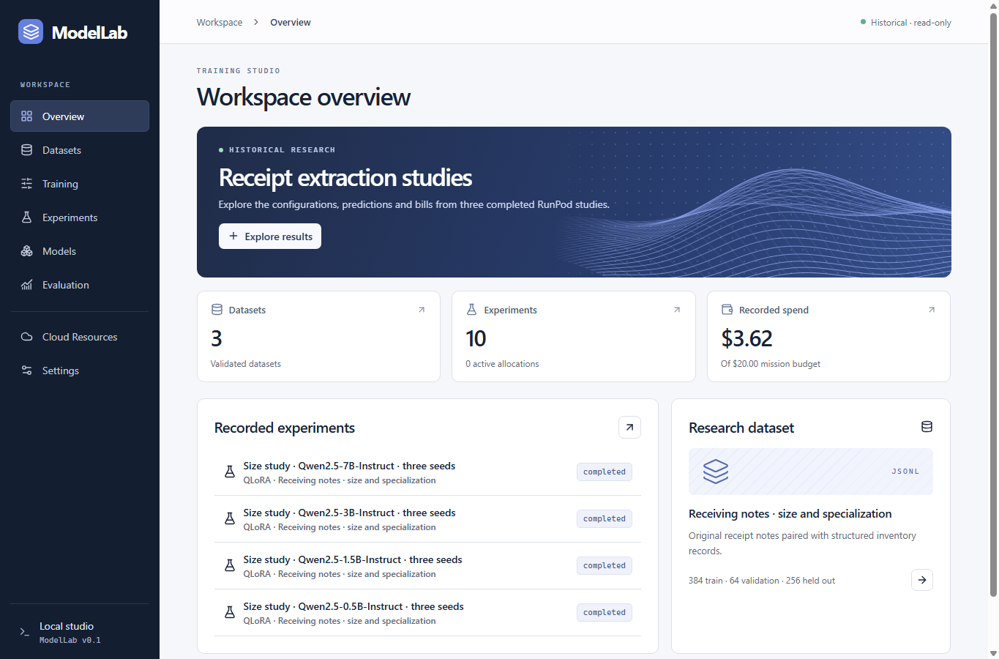
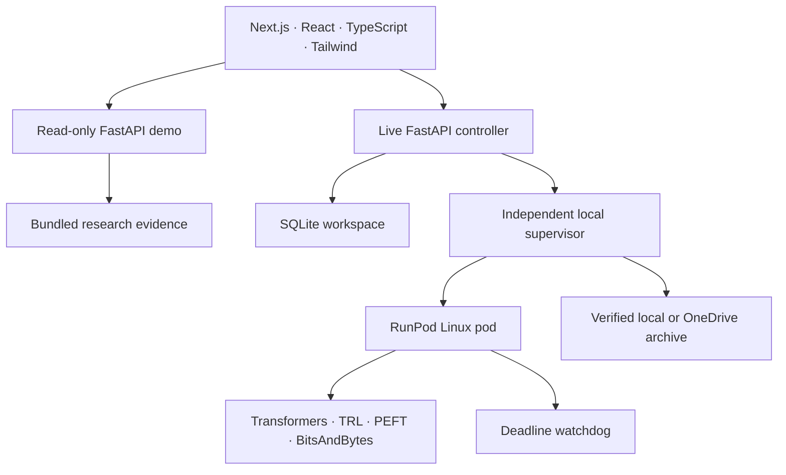

# ModelLab

I built ModelLab to answer a question that a loss curve couldn’t settle for me. When an adapter learns to return clean JSON, has it also learned to read the receipt more accurately?

ModelLab is an open-source cloud AI training and experimentation studio. I use a local Next.js and FastAPI application to manage datasets, review a RunPod quote, follow training, and compare the base model and adapter on the same examples. The public demo opens directly onto the measured research history. I built the application and its verification tools with AI coding assistance.



## What I found

| Study | Result on held-out receipts |
| --- | --- |
| Output formatting | The pilot went from 0/48 strict JSON exact matches to 41/48. Removing one Markdown fence from the base outputs brought them to 40/48. The adapter added one correct extraction after normalization. |
| LoRA rank | A schema-constrained 7B base extracted 56/64 complete records. Ranks 4, 8, 16 and 32 each extracted 63/64. Rank 4 used 1,261,568 trainable parameters and a 5,060,984-byte adapter. This small single-seed test did not establish equivalence among ranks. |
| Model size | The preregistered 1.5B specialist at seed 42 scored 130/256 against 110/256 for the 7B base. The gain was 7.81 percentage points, with a conservative paired 95% interval of −3.50 to +18.88. The direction reversed on development, 32/64 to 62/64. Every tuned 3B seed scored below its own base on the locked test. |

I retained all **7,776 predictions** and the records for **17 trained adapters**. RunPod posted **$3.62171** across ten allocations, including the failed initial pilot attempt. The report includes negative results, paired tests, per-field scores, difficulty categories and seed variability. [Consolidated research report](docs/research.md) · [Public measurements](evidence/summary.json) · [Every arm and denominator](evidence/scores.csv)

## Run the historical demo

Use Python 3.12 or 3.13 and Node.js 22.13 or later with npm. Run the commands from the repository root. The local install contains the web app and controller. PyTorch, CUDA tooling and model weights belong on the remote Linux pod.

**Windows PowerShell**

```powershell
python -m venv .venv
.\.venv\Scripts\python -m pip install -r requirements.txt
npm ci
npm run build
.\.venv\Scripts\python -m studio
```

**Ubuntu**

```bash
python3 -m venv .venv
.venv/bin/python -m pip install -r requirements.txt
npm ci
npm run build
.venv/bin/python -m studio
```

Open [ModelLab on localhost](http://127.0.0.1:8765). The default server reads the bundled evidence. It opens no cloud connection, creates no SQLite workspace and rejects write requests. In **Evaluation**, select the independent receipt study, the 1.5B model and seed 42. Open a failed prediction to compare the exact receipt, reference and generated text. In **Cloud Resources**, follow the historical charges back to individual sessions.

## Inside the studio

| View | What I use it for |
| --- | --- |
| [Dataset inspection](docs/screenshots/dataset.png) | Preview original or imported JSONL/CSV, validate the schema, remove duplicate records, inspect reference lengths and freeze deterministic splits. The worker also records model-tokenizer lengths. |
| [Training configuration](docs/screenshots/training.png) | Inspect or configure model revision, method, learning rate, epochs, batch, accumulation, sequence length, seed, LoRA rank, alpha and dropout. |
| [Historical training metrics](docs/screenshots/metrics.png) | Overlay recorded training and validation losses and compare memory, throughput, timing, configuration and cost. |
| [LoRA rank comparison](docs/screenshots/rank.png) | Switch partitions, prompting arms and paired references. Inspect which fields still fail under the JSON grammar. |
| [Model-size comparison](docs/screenshots/model-size.png) | Compare accuracy with parameter count, adapter bytes, latency and session cost. Inspect Pareto membership and individual seed measurements. |
| [Prediction inspection](docs/screenshots/prediction.png) | Read generated output beside the original receipt, expected JSON, error category and measured latency when available. |
| [Cloud cost management](docs/screenshots/cost.png) | Inspect posted bills in the demo. In a live workspace, discover GPUs, review quotes and inspect inventory and recovery state. |
| [Mobile overview](docs/screenshots/mobile.png) | Navigate the same recorded data on a narrow screen. |

## Architecture and cloud lifecycle



I keep the model cache, training dependencies, active dataset and checkpoints on RunPod. The worker trains LoRA query and value projections. In QLoRA mode it freezes an NF4 double-quantized backbone and uses BF16 compute. The shared scorer measures strict JSON schema, typed field accuracy and complete-record accuracy. The paired analysis matches receipts before counting gains and losses. [Mathematics and worked examples](docs/mathematics.md)

1. In the **live** workspace, import licensed public data or prepare one of the frozen study configurations. Saving a draft is free.
2. Request a quote. The controller checks the GPU, hourly rate, storage estimate, account inventory, balance and the local ledger. Review the maximum estimate and deadline, then explicitly approve that run.
3. The supervisor records allocation intent before requesting a pod. It verifies ownership, stages the dataset and configuration over SSH, checks the dataset digest and starts the worker. The size study reuses remote weights across seeds.
4. Watch measured telemetry or request cancellation. A local supervisor and an independent in-pod watchdog track the absolute deadline. If retrieval fails, a stopped recovery disk can continue to accrue storage charges.
5. On normal completion, the controller verifies the expected files and hashes before deleting the pod and checking provider read-back. Refresh billing when the provider posts usage. **Application safeguards do not guarantee a provider-enforced billing cap.**

### Start your own live workspace

Install OpenSSH client tools and make your own RunPod API key available to the **server process** through `RUNPOD_API_KEY` or your existing user RunPod CLI configuration. The browser never needs the key. The [environment example](.env.example) lists names only. ModelLab does not automatically load that file. A terminal with the project virtual environment activated can start the live workspace with:

```bash
python -m studio --live --port 8766
```

To supply a key interactively without putting its value in shell history, run this in the activated environment:

```bash
python -c "import getpass,os,sys; os.environ['RUNPOD_API_KEY']=getpass.getpass('RunPod key: '); os.execl(sys.executable,sys.executable,'-m','studio','--live','--port','8766')"
```

The live server binds to loopback. Its SQLite database and transport key live under the ignored state directory. On machines with a configured OneDrive sync folder, completed artifacts go under `ModelLab/experiments` there. The fallback is under the local state directory. On Windows, ModelLab checks native Cloud Files metadata before reporting synchronization. Keep recovery files until the artifact and synchronization checks succeed. No Microsoft authentication service is required.

## Reproduce the research

In an activated virtual environment:

```bash
python -m research.public_results
python -m research.report --check
python -m research.reproduce --datasets ./artifacts/generated
python -m unittest discover -s tests
node tests/browser.mjs --demo
```

The first two commands rescore the bundled responses and verify the published tables and report. The dataset command regenerates the three original corpora and fingerprints locally. Browser verification uses an installed Chromium browser and the production build. Set `CHROME_BIN` if discovery cannot find it.

To repeat training on your own RunPod account, run `python -m research.reproduce --drafts pilot`, then the same command with `rank` or `size`. These commands create local drafts only. Open your live workspace to review current stock, price and deadlines before approving any allocation. Training reproductions can incur new provider charges. The pilot’s historical worker sources, rank protocol and size-study source hashes are checked before staging. The public packet contains all original responses and numeric histories, with adapter hashes for comparison. [Evidence guide](evidence/README.md) · [Frozen size design](research/size-design.json)

The studio uses a separate dependency profile for new training jobs. Historical study drafts retain the recorded worker versions. [GPU dependency profiles and security advisories](docs/dependency-security.md)

## Limitations and future work

The receipts are synthetic, in English and drawn from a limited vocabulary. Several examples share templates. Intervals based on individual notes can understate uncertainty across formats. The rank comparison has one seed and the size comparison has three. Quantization, pretraining and architecture vary the interpretation of comparisons across models. Whole-session cost includes shared setup and evaluation. It cannot establish marginal serving cost.

I would next test licensed receipts from independent sources, have reviewers adjudicate ambiguous labels, and register an equivalence margin and sample size before making any equivalence claim. On the engineering side, I would add cooldown-aware invoice reconciliation and a clearer recovery flow for stopped storage.

## AI coding assistance and licensing

I used OpenAI Codex to write and review application code, operate the approved sessions, assemble tests, check the recorded results and prepare this documentation. The screenshots were captured from the running application. The figures and claims can be traced to the released observations. ModelLab code and original receipt generators use the MIT license. Upstream models and dependencies retain their own terms. [License](LICENSE) · [Model and dependency licensing](docs/licensing.md)

[Release verification, security audit and repository inventory](docs/release.md)

## Let's Connect

You can find my projects on [GitHub at sslcat](https://github.com/sslcat).
